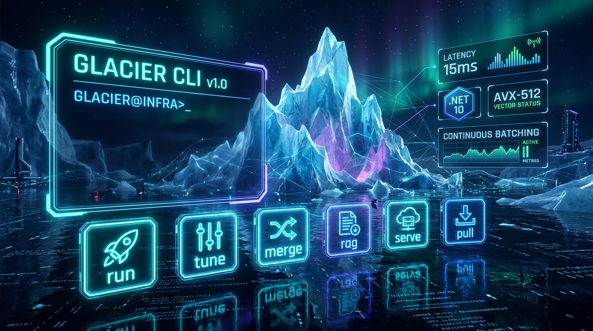

# GLACIER CLI: The Unified Pure C# .NET 10 LLM Tool



<div align="center">

### 🚀 **< 15ms** Cold Start &nbsp;|&nbsp; ⚡ **Zero** Python / C++ &nbsp;|&nbsp; 💎 **100% Pure C# .NET 10**

**One global .NET 10 CLI tool for GGUF inference, LoRA fine-tuning, adapter fusion, GraphRAG, PagedAttention serving, and autonomous agents.**

[](LICENSE)
[](https://dotnet.microsoft.com/)
[](https://www.nuget.org/packages/Glacier.Cli/)
[](https://github.com/ian-cowley)
[](https://glaciersoftware.dev/)
[](https://buymeacoffee.com/glaciersoftware)

</div>

---

## ⚡ Install in One Command

### 📦 Via .NET 10 Global Tool (Recommended):
```bash
dotnet tool install -g Glacier.Cli
```

### 🪟 Windows (PowerShell):
```powershell
irm https://raw.githubusercontent.com/ian-cowley/Glacier.Cli/main/install.ps1 | iex
```

### 🐧 Linux & 🍎 macOS:
```bash
curl -fsSL https://raw.githubusercontent.com/ian-cowley/Glacier.Cli/main/install.sh | bash
```

---

## 🎯 The Universal Command Matrix

| Command | Purpose | Highlight |
| :--- | :--- | :--- |
| **`glacier run`** | Instant GPU/CPU streaming inference & REPL | AVX-512, DirectML, Vulkan, and Native Driver execution |
| **`glacier tune`** | In-process PEFT LoRA fine-tuning | 6.96s / step (46 tok/s, 320 tokens/step, 10-step run) on RTX 4060 |
| **`glacier merge`** | Zero-copy GGUF adapter fusion | Lossless Q8_0 / F16 delta fusion into standalone GGUF |
| **`glacier rag`** | SIMD Vector + CSR Knowledge Graph RAG | Persistent REPL session reuse with hybrid vector + CSR graph hops |
| **`glacier serve`** | Ollama & OpenAI HTTP continuous batching | PagedAttention server with configurable `--host` and `--port` |
| **`glacier pull`** | High-speed chunked GGUF downloader | `HF_TOKEN` auth, HTTP `Range` `.part` resume, strict `GGUF` verification |
| **`glacier agent`** | Autonomous pure C# agent execution | Multi-step LLM tool loop (`--model`) & zero-reflection built-in tools |

---

## ⚡ 60-Second Quickstart

### 1. Instant Inference (Llama 3, Phi-4, DeepSeek, Qwen)
```bash
# Streaming answer to a single prompt
glacier run model.gguf "Explain quantum computing in two sentences"

# Interactive terminal chat REPL
glacier run model.gguf
```

### 2. In-Process Fine-Tuning & Adapter Export
```bash
# Fine-tune directly in pure .NET 10
glacier tune base.gguf --data dataset.jsonl --epochs 3 --rank 16 --out adapter.bin

# Fuse LoRA adapter directly into a standalone production GGUF
glacier merge base.gguf adapter.bin model-enterprise.gguf
```

### 3. In-Process GraphRAG
```bash
# Index documents and stream grounded responses with structural graph hops
glacier rag --model model.gguf --docs ./knowledge --query "What is our architecture?"
```

### 4. Continuous Batching Server (Drop-in Ollama & OpenAI)
```bash
# Serves POST /v1/chat/completions (OpenAI) and POST /api/chat (Ollama)
glacier serve model.gguf --host 127.0.0.1 --port 11434 --blocks 1024 --batch-size 16
```

### 5. Download Foundation Models
```bash
# Pull directly from HuggingFace (set HF_TOKEN for gated models)
glacier pull lmstudio-community/Meta-Llama-3.1-8B-Instruct-GGUF
```

### 6. Autonomous Agent Execution
```bash
# Execute multi-step autonomous tool loop backed by a local GGUF model
glacier agent --model model.gguf "Inspect available GPU accelerators"

# Or invoke built-in pure C# tools directly
glacier agent "CALL devices: {}"
```

---

## 🖥️ Hardware & Model Compatibility

- **Hardware Acceleration**: NVIDIA RTX 40/30 series, AMD RDNA3 (DirectML / Vulkan / HIP), Host CPUs (SIMD AVX-512 & AVX2).
- **Supported Architectures**: Meta Llama 3/3.1/3.2/3.3, Microsoft Phi-4/Phi-3, DeepSeek-V2/V3/R1, Mistral/Devstral, Alibaba Qwen 2/2.5.
- **Quantization Types**: `Q4_K_M`, `Q5_K_M`, `Q6_K`, `Q8_0`, `Q4_0`, `MXFP4`, `F16`, `F32`.

---

## 🆕 What's New in v1.1.0

- **Hardened `glacier pull` Downloader** — added `HF_TOKEN` / `HUGGING_FACE_HUB_TOKEN` Bearer authentication, strict path-traversal containment, `.part` HTTP `Range` resume on `206 Partial Content`, redirected-console cursor safety, and fail-closed `GGUF` magic verification.
- **Persistent `glacier rag` Session Reuse** — hoisted `InferenceSession` outside the interactive REPL loop so model weights and KV caches remain warm across queries.
- **Configurable `glacier serve --host` Binding** — wired `.UseHost(host)` directly into `GlacierServeApp` builder.
- **Real `glacier agent` LLM Loop & Built-In Tools** — wired `IAgentChatModel` over `InferenceSession` (`--model`, `--max-steps`) and registered built-in pure C# tools (`ping`, `clock`, `devices`).
- **Upgraded Ecosystem Dependencies & OIDC Publishing** — upgraded all Glacier Tier 0–3 packages (`Glacier.Inference 1.3.2`, `Glacier.Serve 1.2.0`, `Glacier.Rag 1.2.0`, `Glacier.Agent 1.1.0`, `Glacier.Polaris 1.1.0`) with `TreatWarningsAsErrors` and NuGet Trusted Publishing OIDC.

---

## Credits

Developed by **Ian Cowley** and **Antigravity (Google DeepMind)**.

---

## 📄 License
MIT License. High-Performance Pure C# .NET 10 Ecosystem.

---

## ❄️ Glacier Ecosystem & Support

Part of the **[Glacier Ecosystem](https://glaciersoftware.dev/)** — high-performance, zero-allocation developer tooling and data engines natively built for modern C# and .NET 10.

* 🌐 **Website & Documentation**: [glaciersoftware.dev](https://glaciersoftware.dev/)
* ☕ **Buy Me a Coffee**: [buymeacoffee.com/glaciersoftware](https://buymeacoffee.com/glaciersoftware)
* ❤️ **GitHub Sponsors**: [github.com/sponsors/ian-cowley](https://github.com/sponsors/ian-cowley)
* 🐙 **All Repositories**: [github.com/ian-cowley](https://github.com/ian-cowley)
