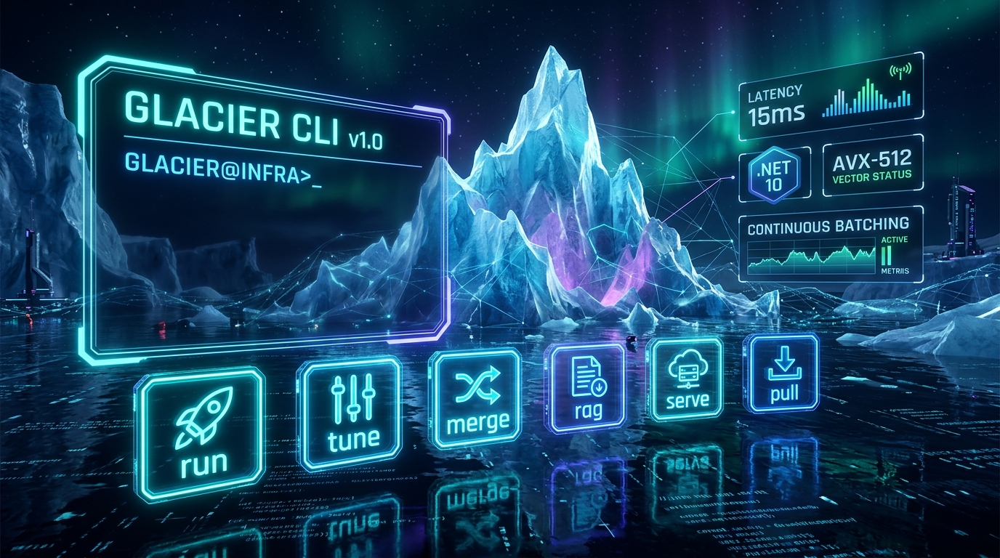

# Glacier.Cli (`glacier`)

[](https://github.com/ian-cowley/Glacier.Cli/actions/workflows/publish-nuget.yml)
[](https://www.nuget.org/packages/Glacier.Cli/)
[](LICENSE)


`Glacier.Cli` provides the `glacier` global .NET 10 command-line tool for running local GGUF models, LoRA fine-tuning, adapter merging, GraphRAG querying, PagedAttention HTTP serving, HuggingFace downloads, autonomous agents, and workspace security audits.

---

## Install

Via .NET 10 global tool:

```bash
dotnet tool install -g Glacier.Cli
```

Or install standalone scripts on Windows PowerShell or Linux/macOS:

```powershell
irm https://raw.githubusercontent.com/ian-cowley/Glacier.Cli/main/install.ps1 | iex
```

```bash
curl -fsSL https://raw.githubusercontent.com/ian-cowley/Glacier.Cli/main/install.sh | bash
```

---

## Quick Start

```bash
# 1. Download a GGUF model from HuggingFace
glacier pull lmstudio-community/Meta-Llama-3.1-8B-Instruct-GGUF

# 2. Run interactive chat REPL or single-prompt inference
glacier run model.gguf "Explain KV caching concisely"

# 3. Serve OpenAI (/v1/chat/completions) and Ollama (/api/chat) APIs locally
glacier serve model.gguf --host 127.0.0.1 --port 11434 --blocks 1024 --batch-size 16

# 4. Query local documents with GraphRAG
glacier rag --docs ./knowledge --model model.gguf --query "How are locks managed?"

# 5. Fine-tune a LoRA adapter and merge into GGUF
glacier tune base.gguf --data train.jsonl --epochs 3 --rank 16 --out adapter.bin
glacier merge base.gguf adapter.bin merged-model.gguf

# 6. Run an autonomous agent or repository security audit
glacier agent --model model.gguf "Inspect available GPU accelerators"
glacier security-check .
```

---

## What You Can Do

| Command | Capability |
| :--- | :--- |
| `glacier run` | Streaming single-prompt generation or interactive REPL (`cuda`/`directml`/`cpu`, LoRA attach, `--split`) |
| `glacier tune` | In-process LoRA fine-tuning from ChatML JSONL with optional `--merge` |
| `glacier merge` | Multi-threaded fusion of LoRA delta weights (`0x41524F4C`) into GGUF (`Q8_0`) |
| `glacier rag` | Hybrid dense vector + CSR knowledge-graph retrieval over local docs (with optional NPU embeddings) |
| `glacier serve` | Continuous-batching PagedAttention HTTP server with Sleep memory consolidation and PeerBounce routes |
| `glacier bounce` | Standalone Peer Critic + OS-sandboxed compiler verification proxy (`--npu-critic`, `--harness`) |
| `glacier pull` | Multi-connection `Range` GGUF downloader with `HF_TOKEN` auth, `.part` resume, SHA-256 & header checks |
| `glacier agent` | Multi-step autonomous `IAgentChatModel` tool loop (`--model`, `--npu`, `--clavier-model`) |
| `glacier devices` | Enumerate GPUs, VRAM, and CPU SIMD capabilities |
| `glacier inspect` | Print GGUF metadata/tensors and run `--audit` bounds/NaN/dequantization integrity checks |
| `glacier audit-adapter` | Verify binary LoRA adapter headers, EOF alignment, norms, and non-zero LoRA-B coverage |
| `glacier bench` | Benchmark cold load, prefill tok/s, and decode tok/s on a GGUF model |
| `glacier config` | View or update persistent acceleration settings |
| `glacier security-check` | Scan files and `.github` workflows for exposed credentials, tokens, and private keys |
| `glacier verify-ecosystem` | Audit MSBuild cross-repo references, retired package IDs, and secret hygiene |

---

## Platform & Compatibility

- **Runtime:** .NET 10 (`net10.0`), `ToolCommandName = glacier`, Native AOT and trimmer compatible.
- **Hardware Acceleration:** NVIDIA CUDA, DirectML, Vulkan/HIP (via `Glacier.Gpu` / `Glacier.Inference`), AMD XDNA 2 NPU sidecar discovery (`--npu` / `auto-npu`), and AVX-512 / AVX2 / NEON CPU SIMD.
- **Model Formats:** GGUF (`Q4_K_M`, `Q5_K_M`, `Q6_K`, `Q8_0`, `Q4_0`, `MXFP4`, `F16`, `F32`) across Llama 3/3.1/3.2/3.3, Phi-3/4, DeepSeek-V2/V3/R1, Mistral, Qwen 2/2.5, and Gemma architectures.

---

## Documentation

- [Command Reference Manual](docs/manual.md) — Exact flags and options for all 15 `glacier` subcommands
- [Architecture](docs/architecture.md) — Subsystem wiring across the Glacier library stack and Native AOT dispatch
- [Changelog](CHANGELOG.md) — Version history (`v1.5.0` to `v1.6.3`)

---

## License & Credits

Licensed under the [MIT License](LICENSE).

Developed by Ian Cowley, Antigravity (Google DeepMind) and Claude.
