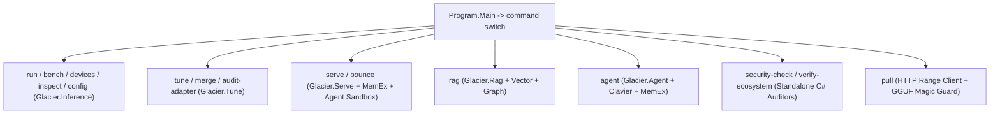

# Glacier.Cli Architecture

`Glacier.Cli` compiles the Glacier C# AI library stack into a single trimmed, Native AOT-compatible global tool binary (`glacier`).

---

## Command Dispatch & Library Integration

---

## Design Characteristics

- **Direct Dispatch (`Program.cs`):** Parses subcommands via a static `switch` expression without reflection or dynamic plugin scanning, preserving fast startup and trim cleanliness (`IsAotCompatible=true`, `EnableTrimAnalyzer=true`).
- **Dual Project/NuGet Graph:** References local sibling Glacier repositories via `ProjectReference` during monorepo development while falling back cleanly to pinned `PackageReference` versions when `UseLocalProjectReferences=false` (verified by `glacier verify-ecosystem` itself).
- **Zero-Secret Hygiene & Adapter Verification:** Bundles standalone C# auditors (`SecurityCheckCommandHandler`, `AdapterAuditCommandHandler`, `VerifyEcosystemCommandHandler`) so releases and checkpoints validate without external Python runtimes.
